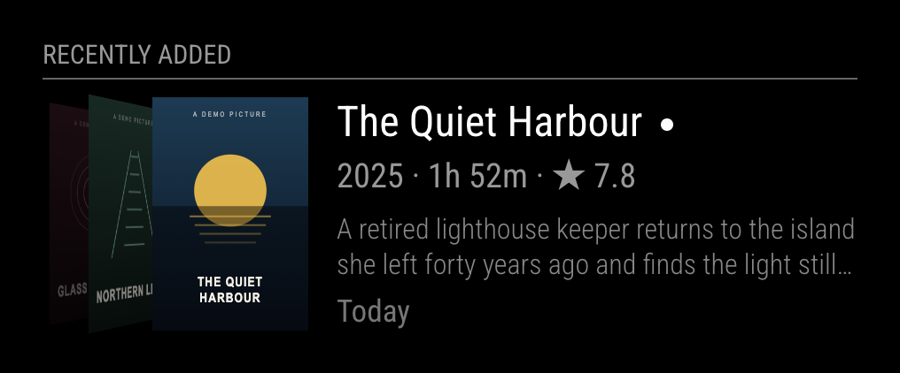
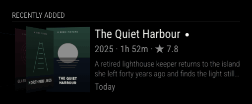

# MMM-RecentlyAdded

A [MagicMirror²](https://magicmirror.builders) module that shows **what's new to watch**:
the movies and shows your [Radarr](https://radarr.video) and [Sonarr](https://sonarr.tv) imported
recently, as one cover flow, newest first.



- Movies and shows share one timeline. A show gets **one cover however many episodes arrived**
  ("3 new episodes · S02E04–06", "S04E08 · Follow the Anger").
- Only the last `days` are shown. With nothing new, the module hides itself.
- A dot marks anything added in the last 24 hours. A new arrival swings to the front.
- Title, year · runtime · IMDb rating (movies) or episode summary (shows), a two-line overview,
  and when it arrived ("Today", "Yesterday", "3 days ago").
- Long titles get two lines and the overview gives up a line, so the text always fits.
- The animation pauses while the screen is off.
- No `npm install`, no build step, no runtime dependencies.



The screenshots come from the built-in [demo](#development) with made-up titles and generated
covers.

## Install

```sh
cd ~/MagicMirror/modules
git clone https://github.com/mkubicek/MMM-RecentlyAdded.git
```

Add it to `config/config.js` and restart MagicMirror:

```js
{
	module: "MMM-RecentlyAdded",
	position: "top_left",
	header: "Recently added",
	config: {
		radarr: { url: "http://nas.local:7878" },
		sonarr: { url: "http://nas.local:8989" }
	}
}
```

Then put the API keys (Radarr/Sonarr → Settings → General → Security → API Key) on the mirror,
readable only by the MagicMirror user:

```sh
mkdir -p ~/.config/MMM-RecentlyAdded
cat > ~/.config/MMM-RecentlyAdded/secrets.json <<'JSON'
{ "radarr": { "apiKey": "…" }, "sonarr": { "apiKey": "…" } }
JSON
chmod 600 ~/.config/MMM-RecentlyAdded/secrets.json
```

Keys may also go inline (`radarr: { url, apiKey }`), but see [Privacy and security](#privacy-and-security)
first. The secrets file can hold the `url` too; values in `config.js` win.

Tested with MagicMirror² 2.18 on a Raspberry Pi 4 (Node 10.24, Electron 16) and Node 22.
Requires Radarr v3+ and Sonarr v3+ (`/api/v3`).

## Options

| Option | Default | Description |
|---|---|---|
| `radarr` | `null` | `{ url, apiKey }` of your Radarr. Leave out to show only shows. |
| `sonarr` | `null` | `{ url, apiKey }` of your Sonarr. Leave out to show only movies. |
| `days` | `7` | How far back imports count as new. |
| `maxItems` | `8` | Most covers to cycle through. |
| `sideCovers` | `2` | Upcoming covers stacked to the left of the current one, 0–3. |
| `newFor` | `86400000` | How long (ms) an import gets the "new" dot. |
| `cycleInterval` | `10000` | Time (ms) each cover is shown. |
| `updateInterval` | `300000` | Time (ms) between Radarr/Sonarr refreshes. |
| `sleep` | `null` | Local times with no animation, e.g. while the screen is off: `{ from: "23:00", to: "06:00" }`. `null` cycles around the clock. |

The module is 460 px wide, like MagicMirror's default side columns.

## How it works

The `node_helper` asks Radarr and Sonarr for their import history of the last `days`
(`/api/v3/history/since`, import events only). Upgrades of a movie count once, at the latest
import; a show's episodes are grouped into one entry, dated by its newest episode.

Posters are fetched by the helper from Radarr/Sonarr's own media cover cache (`poster-250.jpg`),
kept in memory while they are on screen and served to the mirror from its own origin
(`/MMM-RecentlyAdded/poster/…`). The mirror page never talks to Radarr or Sonarr, so there are
no CORS or Chromium Private Network Access problems when the mirror runs on `0.0.0.0`.

Every browser showing the mirror shares one poller per module instance. The page is only
redrawn when the list actually changes.

## Raspberry Pi performance

Between covers nothing moves: no timers besides the cover interval, no animation loops. Each
change is a single CSS transition of the covers (0.9 s) and a text cross-fade. Covers that
are far out of view are `visibility: hidden`, so they aren't painted. During `sleep` the cycle
stops completely. A refresh is two small JSON requests every five minutes; posters are
downloaded once.

## Privacy and security

- MagicMirror sends `config.js` to every browser that opens the mirror (on port 8080, often the
  whole LAN). Keys in `config.js` are therefore readable by anyone who can open the mirror.
  Keys in `~/.config/MMM-RecentlyAdded/secrets.json` are read only by the helper.
- The poster route only serves `poster-250.jpg` of numeric Radarr/Sonarr ids, nothing else from
  those servers.
- Titles, overviews and posters of your library appear on the mirror; that's the point.

## Limitations

- Import history only: something you added but haven't downloaded yet doesn't appear.
- The rating is IMDb's as reported by Radarr; shows don't have one.
- Relative dates use the mirror's local timezone and MagicMirror's `moment`.
- English labels only.

## Development

```sh
npm run demo   # http://localhost:3300 — the real front end with made-up titles and covers
npm test       # node --test, Node 22+
```

`demo/` runs `MMM-RecentlyAdded.js` in a small MagicMirror stand-in; `?active=4` starts on a
given cover and `?cycle=3000` speeds up the rotation.

## License

[MIT](LICENSE). Radarr and Sonarr are independent projects; this module only reads from their APIs.
